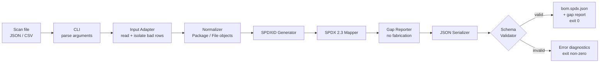

# Project Architecture & Documentation — SPDX Export Tool

**Project:** G370 — Enhanced SPDX Report Export Tool
**Author:** Bibek Roy
**Repository:** https://github.com/bibekbrg/spdx-export-tool

---

## 1. Project Overview

### Purpose
The SPDX Export Tool is a command-line program written in Python. It reads the results of a software compliance scan (a JSON or CSV file) and converts them into a valid **SPDX 2.3 JSON** document. SPDX (ISO/IEC 5962:2021) is the international standard format for a **Software Bill of Materials (SBOM)**: a list of the components inside a piece of software, along with their versions, licenses, file checksums and how they relate to each other.

### Problem it solves
Today, SPDX reports are often built by hand or with one-off scripts. These approaches commonly:
- lose component identifiers or file-level license information,
- leave out dependency relationships,
- produce JSON that fails official SPDX validation, and
- **invent values** for missing data (for example a fake license or checksum) or crash without explaining what was missing.

This tool solves these problems with a repeatable pipeline that maps data the same way every time, never fabricates missing facts, and validates its output against the official SPDX 2.3 schema.

### Objectives
1. Convert scan records (JSON/CSV) into schema-valid SPDX 2.3 JSON.
2. Produce **deterministic** output: the same input always gives the same output.
3. **Never fabricate data.** Missing values become `NOASSERTION` / `NONE` only where the SPDX spec allows it; otherwise the tool reports an error.
4. Produce a clear **gap report** that lists every missing or unmapped field.
5. Achieve 100% schema conformance and ≥85% test coverage.

### Key features
| Feature | Description |
|---|---|
| Input adapters | Read JSON and CSV scan files; set aside malformed rows instead of crashing |
| Normalization | Convert raw rows into clean internal Python objects |
| SPDX 2.3 mapping | Build the document header, packages, files and relationships |
| SPDXID generator | Create unique, repeatable IDs such as `SPDXRef-Package-libfoo-1.0-a1b2c3` |
| Gap reporter | List missing or unmapped fields without guessing |
| Schema validation | Check the output against the official SPDX 2.3 JSON schema |
| JSON serializer | Write pretty-printed UTF-8 JSON with a fixed key order |
| CLI | `spdx-export --input scan.json --output bom.spdx.json` |

### Intended users
- **Compliance officers**, who need SBOMs for audits and customers.
- **Developers and release engineers**, who must ship an SBOM with each release.
- **Open-source program offices (OSPOs)**, which track licenses across many projects.

> Note: the tool produces technical SBOM documents for review. It does **not** give legal approval of license compliance.

---

## 2. Technology Stack

| Area | Technology chosen | Why it was chosen |
|---|---|---|
| Language | **Python 3.10+** | Easy to read, excellent JSON/CSV support built in, and widely used in the SPDX and compliance community |
| Data parsing | `json`, `csv` (standard library) | Built in, so no extra installs; reliable and well documented |
| Data model | `dataclasses` (standard library) | Simple, typed classes for packages, files and diagnostics |
| CLI | `argparse` (standard library) | Standard way to handle command-line arguments in Python |
| Hashing / IDs | `hashlib`, `re` (standard library) | `hashlib` creates short hashes for unique IDs; `re` cleans unsafe characters out of names |
| Validation | **jsonschema** (with optional **spdx-tools**) | Validates output against the official SPDX 2.3 JSON schema file |
| Testing | **pytest** + **coverage.py** | Simple test syntax and coverage reports to measure the ≥85% target |
| Version control | **Git** + **GitHub** | Tracks every change and hosts the public repository |
| CI | **GitHub Actions** | Runs the tests automatically on every push, free for public repos |
| Optional preview (stretch goal) | HTML / CSS / JavaScript | A lightweight browser view of the generated SBOM |

### Database
**No database is needed.** The tool is a file-in → file-out converter: it reads one scan file, processes it in memory, and writes one SPDX file. A database would add setup and complexity with no benefit. If a future version needs to store SBOM history, SQLite would be the first choice because it is a single file and needs no server.

### Alternatives considered
| Chosen | Alternative | Advantages of the alternative | Why the alternative was not chosen |
|---|---|---|---|
| Python | Java | Very strong typing; official SPDX Java tools exist | More boilerplate and slower to learn for a 4-week project |
| Python | Go | Fast, compiles to a single binary | Smaller SPDX ecosystem; less familiar |
| Python | Node.js | Native JSON handling | Weaker CSV/data tooling; the SPDX Python library is the official reference |
| jsonschema | spdx-tools only | Deep SPDX-specific checks | Heavier dependency; jsonschema gives clear, schema-level errors. spdx-tools is kept as an extra check |
| argparse | click / typer | Nicer syntax, automatic help pages | Extra dependency; argparse is enough for a few options |
| dataclasses | pydantic | Built-in data validation | Extra dependency; validation is done by our own rules and the schema |
| pytest | unittest | Built into Python | More verbose; pytest is the industry standard |
| GitHub Actions | Jenkins / GitLab CI | Very flexible | Needs a separate server or platform; Actions is built into GitHub |

---

## 3. Basic Project Architecture

### Folder and file structure
```
spdx-export-tool/
├── src/
│   └── spdx_export/
│       ├── __init__.py
│       ├── cli.py            # Command-line entry point: reads arguments, runs the pipeline
│       ├── adapters/
│       │   ├── json_adapter.py   # Reads JSON scan files
│       │   └── csv_adapter.py    # Reads CSV scan files
│       ├── model.py          # Dataclasses: Package, File, Relationship, Diagnostic
│       ├── normalizer.py     # Cleans raw rows into model objects
│       ├── spdxid.py         # Deterministic SPDXRef-... ID generator
│       ├── mapper.py         # Builds the SPDX 2.3 document structure
│       ├── gaps.py           # Missing-data policy and gap report
│       ├── serializer.py     # Writes pretty, stable-ordered JSON
│       └── validator.py      # Validates output against the SPDX 2.3 schema
├── schemas/
│   └── spdx-schema-2.3.json  # Official SPDX 2.3 JSON schema
├── tests/                    # pytest unit, integration and end-to-end tests
├── samples/                  # Sample scan inputs: valid, missing fields, broken
├── docs/                     # Architecture, field mapping table, missing-data policy
├── .github/workflows/ci.yml  # GitHub Actions: run tests + coverage on every push
├── requirements.txt          # Python dependencies (jsonschema, pytest, coverage)
├── README.md                 # Install steps, usage, mapping summary, limitations
└── .gitignore                # Files Git should not track (caches, virtual envs)
```

### Purpose of each major folder and file
| Folder / file | Responsibility |
|---|---|
| `src/spdx_export/` | All application code, split into one module per pipeline step |
| `schemas/` | The official schema used to prove the output is valid |
| `tests/` | Automated tests that prove each part works and keep it working after changes |
| `samples/` | Example inputs used in demos and as test fixtures |
| `docs/` | Design documents for the mentor and future contributors |
| `.github/workflows/` | CI configuration so tests run automatically |
| `requirements.txt` | One place to install every dependency: `pip install -r requirements.txt` |
| `README.md` | First page visitors see: what the tool does and how to use it |
| `.gitignore` | Keeps generated and private files out of the repository |

### Crucial components and how they interact
1. **CLI (`cli.py`)** receives the user's command and calls each step in order.
2. **Input adapters** turn a JSON or CSV file into a list of raw records. The CLI picks the adapter by file type.
3. **Normalizer** converts raw records into `Package`, `File` and `Relationship` objects defined in **`model.py`**.
4. **SPDXID generator** gives every package and file a unique, repeatable ID.
5. **Mapper** uses the model objects and IDs to build the SPDX document (header, packages, files, relationships).
6. **Gap reporter** checks for missing fields during mapping and records a diagnostic for each one, never guessing values.
7. **Serializer** turns the document into JSON text with a fixed key order.
8. **Validator** checks that JSON against the official schema. Only valid output is saved.

Each component does one job and passes its result to the next, so each one can be tested on its own.

---

## 4. Project Workflow

### Inputs
- A scan results file in **JSON or CSV** containing:
  - package data: name, version, supplier, origin (download URL), declared license, concluded license
  - file data: path, license, SHA1 checksum, owning package
  - relationships: `CONTAINS`, `DEPENDS_ON`
- Command-line options: input path, output path, and optional document name and creation time (for repeatable output).

### Processing steps
1. **Parse arguments:** the CLI checks that the input file exists and the output path is writable.
2. **Read input:** the adapter loads JSON/CSV and sets aside malformed rows.
3. **Normalize:** rows become typed `Package` / `File` objects.
4. **Generate IDs:** each element gets a deterministic `SPDXRef-...` ID.
5. **Map to SPDX:** build the document header, packages, files and relationships.
6. **Check gaps:** apply the missing-data policy (`NOASSERTION`, `NONE`, or error) and log every gap.
7. **Serialize:** write UTF-8 JSON with sorted, stable keys.
8. **Validate:** run the official SPDX 2.3 schema check.
9. **Output:** if valid, save the file and print a summary; otherwise print the errors.

### Outputs
- `bom.spdx.json`: a schema-valid SPDX 2.3 document.
- **Gap report**: a list of missing or unmapped fields.
- **Console summary** and a **POSIX exit code** (`0` = success, non-zero = error).

### Workflow diagram


---

## 5. Git and GitHub Documentation

### Git vs GitHub
| | Git | GitHub |
|---|---|---|
| What it is | A **version control tool** installed on your computer | A **website / cloud service** that hosts Git repositories |
| Works offline? | Yes | No, it needs the internet |
| Main job | Records the history of changes to files | Shares repositories and supports teamwork (issues, pull requests, Actions) |
| Example | `git commit`, `git log` | github.com/bibekbrg/spdx-export-tool |

In short: **Git tracks changes, and GitHub stores and shares them online.**

### Core concepts
| Concept | Meaning |
|---|---|
| **Repository (repo)** | A project folder whose full change history Git tracks. It can be local (on your PC) or remote (on GitHub). |
| **Commit** | A saved snapshot of the project with a message describing the change, e.g. `Add project folder structure`. |
| **Branch** | A separate line of work. `main` holds stable code; a new branch (e.g. `feature/csv-adapter`) lets you work without breaking `main`. |
| **Merge** | Combining the changes from one branch into another, e.g. merging a finished feature branch into `main`. |
| **README file** | `README.md` is the front page of a repo. It explains what the project does, how to install it and how to use it. |
| **.gitignore** | Lists files Git should ignore, such as `__pycache__/`, `.venv/` and coverage reports, so junk and private files are never committed. |

### Common operations
| Operation | Command | Purpose |
|---|---|---|
| **Cloning** | `git clone <url>` | Download a full copy of a GitHub repo to your computer |
| **Staging** | `git add <file>` | Choose which changes go into the next commit |
| **Committing** | `git commit -m "message"` | Save the staged changes as a snapshot in history |
| **Pushing** | `git push` | Upload local commits to GitHub |
| **Pulling** | `git pull` | Download and merge new commits from GitHub to your computer |
| **Issues** | (GitHub website) | Track bugs, tasks and feature ideas, each with a discussion thread |
| **Pull requests (PRs)** | (GitHub website) | Propose merging a branch into `main`; others can review, comment and approve before merging |

### Workflow used in this project
```
edit files → git add → git commit -m "..." → git push → (GitHub Actions runs tests)
```
Example from this project:
```bash
git add .
git commit -m "Add project folder structure"
git push
```

### How GitHub supports collaboration, code management and documentation
- **Collaboration:** pull requests let a mentor review code before it is merged; issues track tasks and bugs; comments keep discussions next to the code.
- **Code management:** full history of every change, branches for safe experimenting, and the ability to roll back mistakes.
- **Automation:** GitHub Actions runs the test suite and coverage report on every push.
- **Documentation:** `README.md` and the `docs/` folder render as formatted pages (including diagrams like the one above) directly on GitHub.

---

## 6. Technical Justification and Conclusion

### Summary of decisions
- **SPDX 2.3 JSON** was chosen as the output format because it is mature, widely supported by tools, and has an official JSON schema to validate against.
- **Python with mostly standard-library modules** keeps the tool simple to install and easy to understand, and needs only three external packages.
- A **pipeline architecture** (adapter → normalizer → mapper → serializer → validator) gives each part a single responsibility.
- **No database** is used because the tool is a stateless file converter.
- **Schema validation and a strict no-fabrication policy** guarantee the output is both valid and truthful.

### Maintainability
- Each module has one clear job, so a bug can be found and fixed in one place.
- Automated tests (≥85% coverage) and CI catch mistakes before they reach `main`.
- Documentation (README, mapping table, missing-data policy) explains *why* the tool behaves as it does.

### Scalability
- Processing happens in memory using simple lists and dictionaries; the performance target is **1,000 files + 50 packages in under 3 seconds**.
- New input formats only need a new **adapter**; the rest of the pipeline stays the same.

### Future enhancements
- **SPDX Tag:Value** output format (a new serializer).
- **HTML preview** of the package hierarchy in a browser.
- **Evidence bundle**: a zip containing the SBOM plus referenced license texts.
- **Configurable mapping profiles** for other scanners (e.g. FOSSology, ScanCode).
- Support for **SPDX 3.0** as tools adopt it.

### Conclusion
The SPDX Export Tool is designed as a small, well-structured Python pipeline that turns scan results into trustworthy, standards-compliant SBOMs. Its modular design, strict validation, no-fabrication policy and automated testing make it reliable today and easy to extend in the future.
